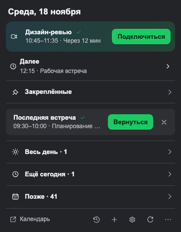
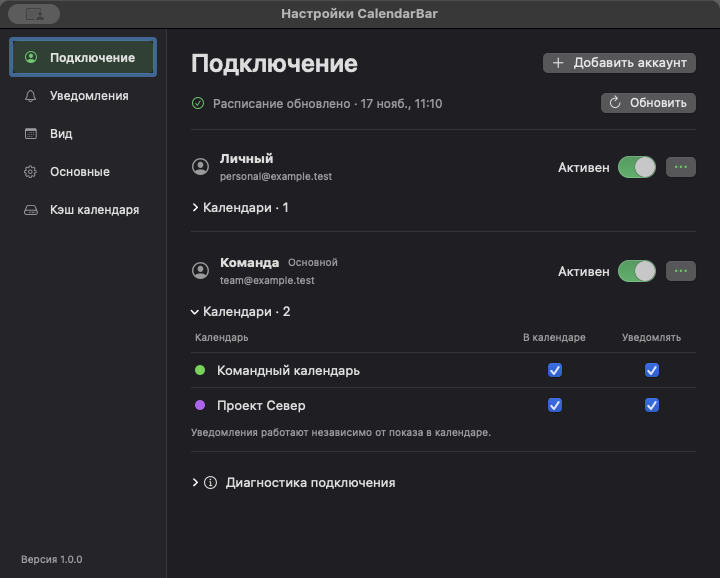
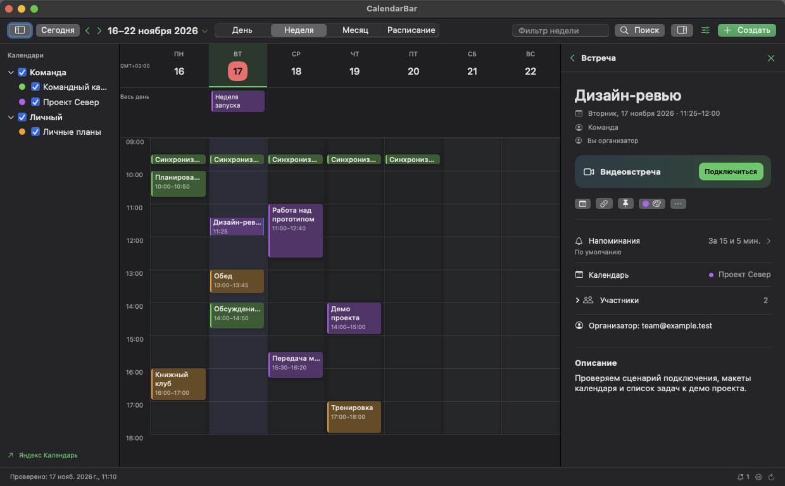

# CalendarBar

Яндекс Календарь в строке меню macOS и в области уведомлений Windows. Проверьте, сколько времени осталось до встречи, откройте расписание или подключитесь к звонку.

## Возможности

- Календарь в режимах «День», «Неделя», «Месяц» и «Расписание». Есть поиск по загруженным событиям и свободные промежутки в рабочее время.
- Несколько аккаунтов Яндекса с отдельными календарями, цветами и настройками уведомлений.
- Системные напоминания, утренний обзор и история новых, изменённых и отменённых встреч.
- Подключение к видеовстречам и закрепление часто используемых ссылок.
- Локальный кэш для просмотра расписания без сети. Можно очистить данные одного аккаунта или весь кэш, сохранив подключения и настройки.

Создание, редактирование и ответы на приглашения открываются в веб-версии Яндекс Календаря. CalendarBar читает события через CalDAV.

## Интерфейс

На всех снимках вымышленные аккаунты, встречи и ссылки с доменом `example.test`.

| | macOS | Windows |
| --- | --- | --- |
| **Панель** |  |  |
| **Настройки** |  |  |

### Календарь macOS



### Календарь Windows


Снимки Windows показывают интерфейс приложения с демо-данными. Они подготовлены на Mac через Windows-рендерер проекта.

## Установка 1.0.0

| Платформа | Файл | Требования |
| --- | --- | --- |
| macOS | `CalendarBar-macOS-1.0.0.zip` | Apple Silicon или Intel, macOS 13 или новее. Локальный расчёт повторений доступен с macOS 15. |
| Windows x64 | `CalendarBar-Windows-1.0.0-x64-Setup.exe` | Windows 10 или 11. Мастер загружает WebView2, если его ещё нет. |
| Windows x64, корпоративный ПК | `CalendarBar-Windows-1.0.0-x64-PerUser-Setup.exe` | Установка в профиль текущего пользователя без запроса прав администратора. Нужен установленный Microsoft Edge WebView2 Runtime. |

На macOS распакуйте архив и перенесите `CalendarBar.app` в «Программы». На Windows запустите подходящий установщик. Перед обновлением завершите CalendarBar командой **Выход** в панели. Подробнее о профилях и установщиках описано в [документации Windows](WindowsTauri/README.md).

Архив macOS собран с локальной подписью без нотарификации Apple. Установщики Windows без Authenticode-подписи. На компьютерах с корпоративными правилами запуск зависит от настроек ИТ-службы.

### Подключение Яндекс Календаря

1. Откройте **Настройки → Подключение**.
2. Введите полную почту Яндекса и [пароль приложения типа «Календарь»](https://id.yandex.ru/security/app-passwords).
3. Выберите нужные календари и отправьте тест через **Настройки → Уведомления**.

Пароли хранятся в Связке ключей на macOS и защищаются системным механизмом DPAPI на Windows. Сохранённые события и настройки находятся в локальном профиле.

## Сборка из исходников

### macOS

Нужен полный Xcode 16 или новее. Из корня проекта:

```sh
./Build.command --build-only
```

Скрипт запускает тесты и создаёт `dist/CalendarBar.app` для архитектуры текущего Mac.

### Windows

Нужны Node.js, Rust Stable и Visual Studio Build Tools с C++ и Windows SDK. Из корня проекта:

```powershell
cd WindowsTauri
npm ci
npm run build:windows
```

Для корпоративного установщика используйте `npm run build:windows:per-user`. Выходные файлы и тесты описаны в [документации Windows](WindowsTauri/README.md).

## Демо

Нативное демо для macOS запускается из корня проекта:

```sh
./script/build_and_run.sh --demo
```

В меню **Демо** можно открыть панель встреч, календарь и настройки. Приложение использует отдельный демонстрационный профиль, а синхронизация и системные напоминания в нём отключены.

Демо интерфейса Windows запускается из корня проекта:

```sh
npm ci --prefix Windows
npm --prefix WindowsTauri run start:electron
```

Чтобы переснять галерею Windows, запустите `npm --prefix WindowsTauri run start:electron -- --screenshots`. Снимки сохранятся в `docs/screenshots`.

## Структура проекта

- `Sources/CalendarBar` и `Sources/CalendarCore` содержат приложение macOS на SwiftUI/AppKit и логику календаря на Swift.
- `WindowsTauri` содержит приложение Windows на Tauri и Rust. Сборка берёт HTML, JavaScript и стили интерфейса из `Windows/src`.
- `Tests` и [план ручной проверки](TEST-PLAN.md) охватывают разбор календаря, повторения, кэш и сценарии приложения.
