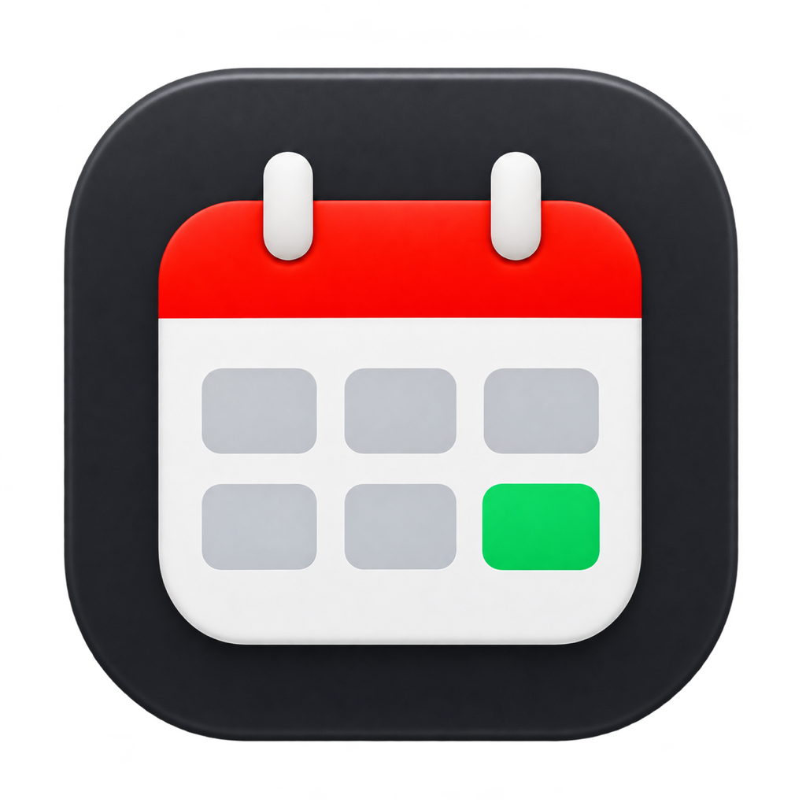
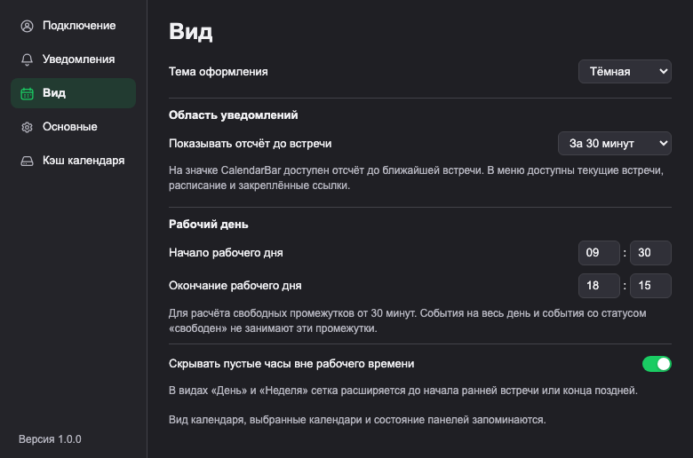
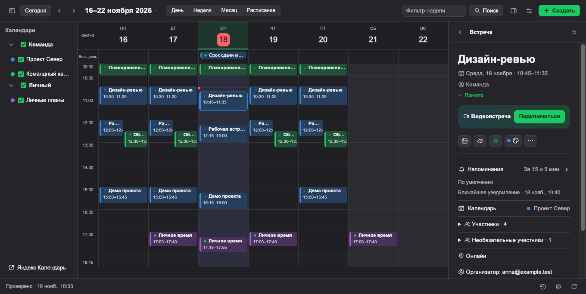

<h1 align="center">
   
  CalendarBar
</h1>

  

  
  
  
  
  

  
  
  

  
  

**CalendarBar** — независимый клиент для Яндекс Календаря с быстрым подключением к встречам в **Яндекс Телемосте**. Расписание и отсчёт до встречи всегда под рукой в строке меню macOS и в трее Windows.

## Зачем я сделал CalendarBar

Я периодически пропускал встречи. Письмо с приглашением легко терялось среди других, и о встрече я мог узнать, когда она уже началась. Поэтому я сделал CalendarBar. Теперь вижу ближайшие встречи прямо в системной панели, получаю напоминания и больше не пропускаю их из-за незамеченных писем.

Приложение я разработал с помощью **Codex**. Он помог превратить идею в работающие версии для macOS и Windows.

## 📅 Что умеет CalendarBar

- **Расписание под рукой.** Панель показывает текущие и ближайшие встречи, события на весь день и закреплённые ссылки. Оттуда можно быстро открыть календарь, карточку встречи и настройки.
- **Календарь и поиск.** Смотрите день, неделю, месяц или расписание. Ищите по загруженным событиям, в том числе по названию, участникам и описанию. Свободные промежутки помогают подобрать время для новой встречи.
- **Карточка встречи.** В ней видны время, участники, статус приглашения и ссылка на звонок. Создание, редактирование и ответы на приглашения открываются в Яндекс Календаре.
- **Личные напоминания и история.** Настройте напоминания до начала, отложите конкретное уведомление или задайте исключение для встречи или серии. История хранит изменения расписания.
- **Несколько аккаунтов и офлайн-просмотр.** Рабочие и личные календари можно смотреть одновременно. Загруженное расписание доступно без сети.

## 🖼️ Интерфейс

На всех снимках вымышленные аккаунты, встречи и ссылки с доменом `example.test`.

| | macOS | Windows |
| --- | --- | --- |
| **Панель** |  |  |
| **Настройки** |  |  |

### Календарь Windows

Снимки Windows показывают интерфейс приложения с демо-данными. Они подготовлены на Mac через Windows-рендерер проекта.

## ⚙️ Настройки

| Раздел | Что настроить и зачем |
| --- | --- |
| **Подключение** | Добавьте аккаунты Яндекса и задайте им понятные имена. Для каждого календаря отдельно выберите, показывать ли события и присылать ли уведомления. Например, можно скрыть личный календарь из сетки и продолжать получать напоминания. |
| **Уведомления** | Задайте время первого и повторного напоминаний. Выберите, какие изменения расписания требуют уведомления, и включите утренний обзор. Кнопка «Проверить» помогает проверить системные уведомления. |
| **Вид** | Выберите тему, интервал показа отсчёта до встречи и рабочие часы. Календарь использует рабочие часы для расчёта свободных промежутков. В Windows можно задать часы и минуты, а число минут до встречи видно на значке у часов. |
| **Основные** | Настройте автозапуск и интервалы фонового обновления в рабочее и остальное время. Ручное обновление остаётся доступным из приложения. |
| **Кэш календаря** | Посмотрите общий объём кэша и размер по аккаунтам. Можно удалить загруженные события одного аккаунта или всех сразу. Подключения, закрепления и настройки сохраняются. |

Цвет можно выбрать для календаря, отдельной встречи или всей серии. Это меняет отображение в CalendarBar.

## ⬇️ Установка

Откройте раздел **Releases** этого репозитория и скачайте файл для своей платформы.

| Платформа | Файл |
| --- | --- |
| macOS 13+, Apple Silicon и Intel | `CalendarBar-macOS-1.0.0.dmg`. Откройте образ, перетащите CalendarBar в «Программы» и запустите оттуда. |
| Windows 10 и 11, x64 | `CalendarBar-Windows-1.0.0-x64-Setup.exe`. При необходимости установщик загрузит WebView2. |
| Windows x64, установка для текущего пользователя | `CalendarBar-Windows-1.0.0-x64-PerUser-Setup.exe`. Права администратора не нужны. Требуется установленный WebView2. |

Образ macOS поставляется без нотарификации Apple, установщики Windows — без цифровой подписи. Запуск на корпоративном ПК зависит от политики ИТ-службы.

Откройте **Настройки → Подключение**, введите адрес почты и [пароль приложения Яндекс ID типа «Календарь»](https://id.yandex.ru/security/app-passwords). Затем выберите нужные календари. Пароли хранятся в Связке ключей macOS или защищаются DPAPI в Windows.

На Mac, если «Связка ключей» просит предоставить CalendarBar доступ к записи `com.nbord.CalendarBar.caldav`, введите пароль связки «Вход» (обычно это пароль входа в Mac) и выберите **«Разрешать всегда»**. Это позволяет читать сохранённый пароль без повторного запроса при следующих запусках. После обновления приложения macOS может запросить разрешение снова. [Справка Apple](https://support.apple.com/en-gb/guide/mac-help/kychn002/mac)

## Разработка

[macOS — сборка, тесты и демо](docs/macos/README.md) · [Windows — сборка, установщики и демо](WindowsTauri/README.md)

## Лицензия

[MIT License](LICENSE). CalendarBar можно использовать, изменять и распространять с сохранением уведомления об авторских правах и текста лицензии.
